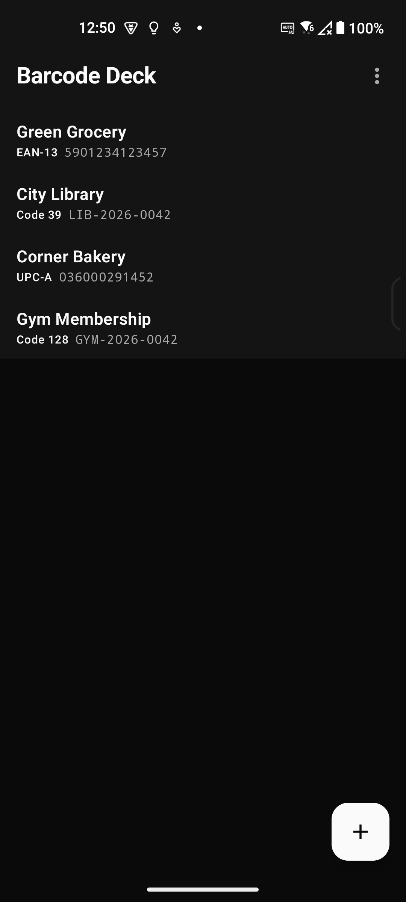
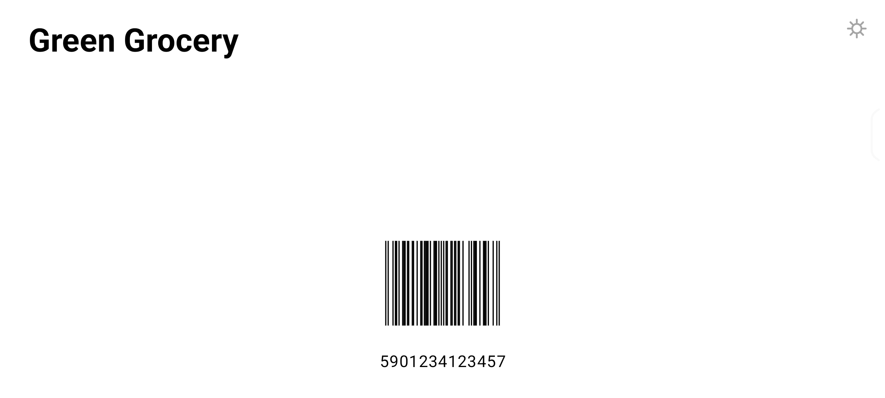
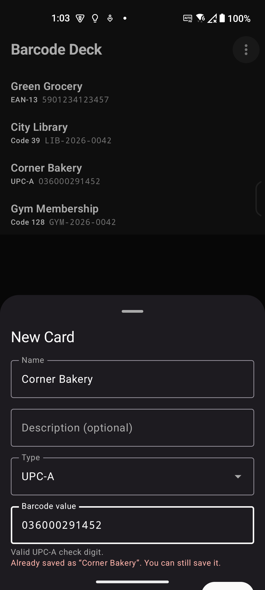
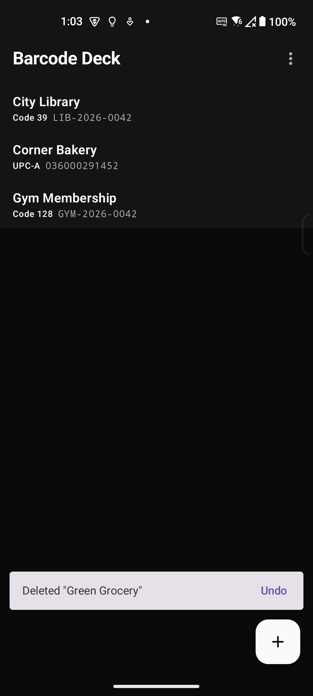

# Barcode Deck

**Stop digging for plastic cards at the checkout.** Barcode Deck turns your phone into any membership, loyalty, library, or gym card: pick the card, show the barcode, be on your way.

It is **100% free, open source, and offline**. No account, no sign-up, no cloud, no ads, no analytics — your cards live on your phone and nowhere else. The only permission the app asks for is the camera, and it is used exclusively to look at barcodes.

## Why install it?

Phone wallets can't hold the long tail of everyday cards: your local grocery, the bakery, the gym, the library — merchants don't issue digital passes for those, and typing numbers by hand at the register is a lottery. Barcode Deck shows **any** barcode, big, sharp, and high-contrast, in a single tap — rendered the way scanners actually read them, from a 30-year-old laser to the newest imager.

One card less in the wallet. One app instead of twelve.

## What it does

- **Scan** any barcode with the camera — EAN-13, UPC-A/UPC-E, Code 39, Code 93, Code 128, ITF, Codabar, PDF417 and more, recognized entirely on-device.
- **Type it in** manually when there is nothing to scan — with a barcode-type selector, live format validation, check-digit verification, and duplicate detection.
- **Present** any card full-screen in landscape, rendered to true GS1 proportions (EAN-13, UPC-A, Code 39, Code 128) so real scanners read it on the first try.
- **Save, restore, and share your whole deck**: export everything to a single, human-readable JSON file — keep it as a backup, restore it on a new phone, or hand it to another device. No servers involved: the file is yours.
- **Organize** your deck: long-press and drag to reorder; deleting shows a 5-second undo bar, then the card is permanently gone.

Everything happens on your device. The Android build does not even hold the network permission, so the app cannot phone home even if it wanted to.

## Screenshots

Captured from the Android app with demo data:

| Card list | Presenting at the scanner |
| --- | --- |
|  |  |
| **Adding a card, with live validation** | **Deleting, with a 5-second undo** |
|  |  |

## The projects

| Folder | Platform | Stack |
| --- | --- | --- |
| [`barcode-deck-ios/`](barcode-deck-ios/) | iOS 17+ | Swift, SwiftUI, SwiftData, Vision, XcodeGen (`project.yml`) |
| [`barcode-deck-android/`](barcode-deck-android/) | Android 8.0+ | Kotlin, Jetpack Compose, Room, CameraX, ML Kit (on-device) |

Each folder is a self-contained app: open `barcode-deck-ios/BarcodeDeck.xcodeproj` in Xcode, or import `barcode-deck-android/` into Android Studio.

## Privacy

- Cards are stored locally on the device and never leave it — there is no server, no sync, and no telemetry.
- The Android manifest does not request the Internet permission at all.
- Camera access is used only for scanning barcodes; nothing is recorded or uploaded.
- Exports and imports are plain files you create and share yourself.

## License

[MIT](LICENSE) — the same license applies to the [`barcode-deck-ios/`](barcode-deck-ios/LICENSE) and [`barcode-deck-android/`](barcode-deck-android/LICENSE) projects.

*Barcode Deck is not a payment app and does not replace payment cards.*

Proudly developed via <strong>[GLM 5.3 Flash (EXL3)](https://github.com/MiaAI-Lab/GLM-5.3-Flash-EXL3-2x-DGX-Sparks-TensorFold)</strong> and my 3X DGX Sparks
